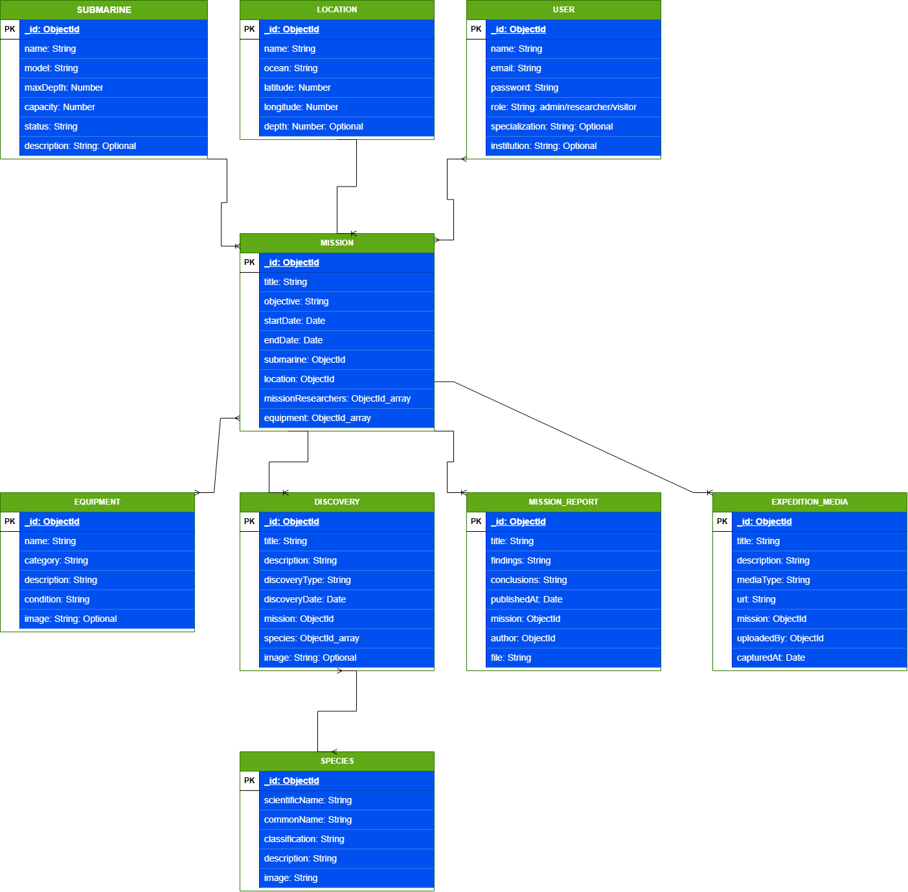

# DeepSea Expeditions Backend API

## Overview

This repository contains the Node.js, Express, and MongoDB backend for DeepSea Expeditions. It provides authentication and APIs for missions, submarines, equipment, locations, users, marine species, and scientific discoveries.

The frontend uses this API to retrieve records, submit forms, manage mission participation, and upload images. Mongoose models describe the database records and their relationships. Protected endpoints verify a JSON Web Token sent in the request header.

## Related Links

- **Backend API:** [deployed backend](https://backend-deepsea.onrender.com/).
- **Frontend Application:** 
- **Frontend Repository:** [frontend-deepSea](https://github.com/aalebreeq1/frontend-deepSea)
- **Backend Repository:** [backend-deepSea](https://github.com/aalebreeq1/backend-deepSea)

## Technologies Used

- **Node.js** — JavaScript runtime.
- **Express** — HTTP server, middleware, and routing.
- **MongoDB** — document database.
- **Mongoose** — schemas, validation, queries, and relationships.
- **JSON Web Tokens (jsonwebtoken)** — bearer-token authentication.
- **bcrypt** — password hashing and password comparison during authentication.
- **dotenv** — environment configuration.
- **Morgan** — HTTP request logging.
- **CORS** — browser access from the configured frontend origin.
- **Multer** — multipart image uploads using memory storage.
- **Cloudinary** — image storage and delivery.
- **express-rate-limit** — rate-limit middleware definitions; not currently mounted.
- **Jest and Supertest** — installed testing tools; automated test suites have not been committed.

## Features

- Registration with a Visitor or Researcher role; public signup does not accept Admin.
- Login using a username and password, returning user data and a token valid for one hour.
- JWT authentication middleware for protected endpoints.
- CRUD endpoints for seven database models.
- Role-based authorization for missions, submarines, species, discoveries, and image uploads.
- Mission and submarine status updates.
- Mission researcher-list updates.
- MongoDB relationships between missions, users, submarines, equipment, locations, discoveries, and species.
- Populated mission and discovery responses for related records.
- Image uploads with file-type, size, and file-count limits.
- JSON responses with success and error status codes.
- Request logging and CORS configuration.

Logout is handled by the frontend removing its stored token. There is no backend logout or token-revocation endpoint.

### Current Authorization

For missions, submarines, species, and discoveries, Admins and Researchers can create and update records; only Admins can delete them. Their read endpoints are public. Image uploads require an Admin or Researcher account.

Equipment, location, and user routes currently use the authentication checks listed in the endpoint tables. They do not have the same role checks as mission and submarine routes.

Rate-limit middleware is defined in middleware/rateLimiters.js, but is not connected to the server or routes. Server-side search, filtering, and pagination are not currently implemented.

## Project Structure

~~~text
backend-deepSea/
├── config/
│   ├── cloudinary.js
│   └── db.js
├── middleware/
│   ├── rateLimiters.js
│   ├── uploadImage.js
│   ├── validateObjectId.js
│   └── verifyToken.js
├── models/
│   ├── Discovery.js
│   ├── Equipment.js
│   ├── Location.js
│   ├── Mission.js
│   ├── Species.js
│   ├── Submarine.js
│   └── User.js
├── routes/
│   ├── auth.routes.js
│   ├── discoveryRoutes.js
│   ├── equipment.routes.js
│   ├── location.routes.js
│   ├── mission.routes.js
│   ├── speciesRoutes.js
│   ├── submarine.routes.js
│   ├── upload.routes.js
│   └── user.routes.js
├── deepSea.ERD.png
├── package.json
├── README.md
└── server.js
~~~

### Folder Responsibilities

| Folder or file | Purpose |
| --- | --- |
| config/ | MongoDB connection and Cloudinary configuration. |
| middleware/ | JWT verification, image-upload validation, and additional middleware definitions. |
| models/ | Mongoose schemas and relationships. |
| routes/ | Endpoint definitions and HTTP request/response handling. |
| server.js | Express configuration, route mounting, database connection, and server startup. |
| deepSea.ERD.png | Existing database design diagram. |

Requests are handled directly in route files. The project does not currently have separate controllers/, tests/, or app.js files.

## Getting Started

### Prerequisites

Install or prepare:

- Node.js 22.12 or later and npm.
- Git, to clone the repository.
- MongoDB locally or a MongoDB Atlas account and connection string.
- A Cloudinary account for image uploads.

For MongoDB Atlas, configure database credentials and network access for the machine running the API.

## Installation

### 1. Clone the repository

~~~bash
git clone https://github.com/aalebreeq1/backend-deepSea.git
cd backend-deepSea
~~~

### 2. Install dependencies

~~~bash
npm install
~~~

### 3. Create the environment file

Create .env in the backend root directory:

~~~env
PORT=3000
MONGODB_URI=mongodb://127.0.0.1:27017/deepsea
CLIENT_URL=http://localhost:5173
JWT_SECRET=replace_with_a_long_random_secret
CLOUDINARY_CLOUD_NAME=your_cloud_name
CLOUDINARY_API_KEY=your_api_key
CLOUDINARY_API_SECRET=your_api_secret
~~~

Replace MONGODB_URI with your Atlas connection string when using MongoDB Atlas. Set CLIENT_URL to the frontend origin used by the browser. Cloudinary credentials are used by the upload endpoint.

### 4. Start the development server

The development script uses Nodemon. It is not currently declared in package.json, so install it before using that script:

~~~bash
npm install --save-dev nodemon
npm run dev
~~~

To run the existing server without installing Nodemon:

~~~bash
npm start
~~~

The local API base URL is [http://localhost:3000](http://localhost:3000). Use a resource path such as /species or /submarine to make a request; no home or health-check endpoint is defined.

## Database Models

All models have an automatically generated MongoDB _id of type ObjectId. The current schemas do not enable automatic createdAt or updatedAt timestamps.

### User

| Field | Type | Rules |
| --- | --- | --- |
| username | String | Required, unique, trimmed, lowercase. |
| email | String | Required, unique, lowercase. |
| hashedPassword | String | Required; registration creates a bcrypt hash. Omitted from JSON serialization. |
| role | String | Required: admin, researcher, or visitor. Public signup accepts only visitor or researcher. |
| specialization | String | Optional. |
| institution | String | Optional. |

Registration accepts a plaintext password of at least six characters and stores its hash as hashedPassword. The /user CRUD routes accept model fields directly and do not perform the registration endpoint's password hashing.

### Mission

| Field | Type | Rules |
| --- | --- | --- |
| title | String | Required. |
| objective | String | Required. |
| startDate | Date | Required. |
| endDate | Date | Optional. |
| status | String | Required: planned, active, completed, or suspended. Creation sets planned. |
| submarine | ObjectId | Required reference to Submarine. |
| location | ObjectId | Required reference to Location. |
| missionResearchers | ObjectId array | References to User records. |
| equipment | ObjectId array | References to Equipment records. |

### Submarine

| Field | Type | Rules |
| --- | --- | --- |
| name | String | Required. |
| model | String | Required. |
| maxDepth | Number | Required; maximum depth in meters. |
| capacity | Number | Required; crew capacity. |
| status | String | Required: operational, under_maintenance, or retired. Creation sets operational. |
| description | String | Optional. |
| image | String | Optional image URL. |

### Equipment

| Field | Type | Rules |
| --- | --- | --- |
| name | String | Required. |
| category | String | Required: Imaging, Navigation, Sampling, Communication, Robotics, or Scientific Sensors. |
| condition | String | Required: operational, needs_maintenance, or out_of_service. |
| description | String | Optional. |
| image | String | Optional image URL. |

### Location

| Field | Type | Rules |
| --- | --- | --- |
| name | String | Required. |
| ocean | String | Required. |
| latitude | Number | Required. |
| longitude | Number | Required. |
| depth | Number | Optional. |

### Species

| Field | Type | Rules |
| --- | --- | --- |
| scientificName | String | Required. |
| commonName | String | Optional. |
| classification | String | Required. |
| description | String | Required. |
| image | String | Optional image URL. |

### Discovery

| Field | Type | Rules |
| --- | --- | --- |
| title | String | Required. |
| description | String | Required. |
| discoveryType | String | Required: New Species, Geological Formation, Shipwreck, or Ecosystem. |
| discoveryDate | Date | Required. |
| mission | ObjectId | Required reference to Mission. |
| species | ObjectId array | References to Species records. |
| image | String | Optional image URL. |

The tables describe schema rules. Update validation is enabled explicitly on equipment, location, user, discovery, and species updates. Mission and submarine updates do not currently pass runValidators: true.

## Entity Relationships

The existing diagram includes planned Mission Report and Expedition Media entities. Those two models and their endpoints are not implemented. The tables above describe the current schemas.

- Each mission references one submarine and one location. A submarine or location can be used by multiple missions.
- Missions store arrays of researcher user IDs and equipment IDs. Users and equipment can participate in multiple missions.
- Each discovery references one mission. A mission can have multiple discoveries.
- Discoveries store arrays of species IDs. A species can appear in multiple discoveries.

## API Base URL

- **Local development:** [http://localhost:3000](http://localhost:3000)
- **Production:** Deployment URL not provided in the project files.

Routes use singular prefixes such as /mission, /submarine, and /species. There is no /api prefix.

### Authentication

Send the token returned by login with protected requests:

~~~http
Authorization: Bearer YOUR_ACCESS_TOKEN
~~~

Use Content-Type: application/json for JSON bodies. Image uploads use multipart/form-data.

## Endpoints

**Public** means no token is required. **Authenticated** means any account with a valid token, including a Visitor. **Admin / Researcher** and **Admin** indicate additional role checks.

### Authentication

| Method | Endpoint | Access | Description |
| --- | --- | --- | --- |
| POST | /auth/sign-up | Public | Register a Visitor or Researcher account. |
| POST | /auth/sign-in | Public | Return an access token and user data after verifying credentials. |

Example registration body:

~~~json
{
  "username": "ocean_researcher",
  "email": "researcher@example.com",
  "password": "example-password",
  "role": "researcher"
}
~~~

The role defaults to visitor if omitted. Login accepts username and password, and returns an accessToken and a user object.

### Missions

| Method | Endpoint | Access | Description |
| --- | --- | --- | --- |
| GET | /mission | Public | Get missions with populated submarine, location, researcher, and equipment references. |
| GET | /mission/:id | Public | Get one mission with populated references. |
| POST | /mission | Admin / Researcher | Create a mission with status planned. |
| PUT | /mission/:id | Admin / Researcher | Update mission fields, researcher IDs, and equipment IDs. |
| PATCH | /mission/:id/status | Admin / Researcher | Update mission status. |
| PATCH | /mission/:id/researchers | Admin / Researcher | Replace the mission's researcher ID array. |
| DELETE | /mission/:id | Admin | Delete a mission. |

A status body can be { "status": "active" }. Researcher updates accept { "missionResearchers": ["USER_OBJECT_ID"] }, using real user IDs. That endpoint replaces the full array; it does not accept a separate join or leave action.

Collection responses contain missions; individual record responses contain mission. An empty mission collection returns 404 with No missions found.

### Submarines

| Method | Endpoint | Access | Description |
| --- | --- | --- | --- |
| GET | /submarine | Public | Get all submarines. |
| GET | /submarine/:id | Public | Get one submarine. |
| POST | /submarine | Admin / Researcher | Create a submarine with status operational. |
| PUT | /submarine/:id | Admin / Researcher | Update submarine details. |
| PATCH | /submarine/:id/status | Admin / Researcher | Update submarine status. |
| DELETE | /submarine/:id | Admin | Delete a submarine. |

A status body can be { "status": "under_maintenance" }. Collection responses contain submarines; individual record responses contain submarine.

### Equipment

| Method | Endpoint | Access | Description |
| --- | --- | --- | --- |
| GET | /equipment | Public | Get all equipment records. |
| GET | /equipment/:id | Authenticated | Get one equipment record. |
| POST | /equipment | Authenticated | Create an equipment record. |
| PUT | /equipment/:id | Authenticated | Update an equipment record. |
| DELETE | /equipment/:id | Authenticated | Delete an equipment record. |

### Locations

| Method | Endpoint | Access | Description |
| --- | --- | --- | --- |
| GET | /location | Public | Get all locations. |
| GET | /location/:id | Public | Get one location. |
| POST | /location | Authenticated | Create a location. |
| PUT | /location/:id | Authenticated | Update a location. |
| DELETE | /location/:id | Authenticated | Delete a location. |

### Users

| Method | Endpoint | Access | Description |
| --- | --- | --- | --- |
| GET | /user | Authenticated | Get all users. |
| GET | /user/:id | Authenticated | Get one user. |
| POST | /user | Authenticated | Create a user directly from model fields. |
| PUT | /user/:id | Authenticated | Update a user record. |
| DELETE | /user/:id | Authenticated | Delete a user record. |

Use /auth/sign-up for normal registration and password hashing.

### Discoveries

| Method | Endpoint | Access | Description |
| --- | --- | --- | --- |
| GET | /discovery | Public | Get discoveries with populated mission and species references. |
| GET | /discovery/:id | Public | Get one discovery with populated references. |
| POST | /discovery | Admin / Researcher | Create a discovery. |
| PUT | /discovery/:id | Admin / Researcher | Update a discovery. |
| DELETE | /discovery/:id | Admin | Delete a discovery. |

### Species

| Method | Endpoint | Access | Description |
| --- | --- | --- | --- |
| GET | /species | Public | Get all species. |
| GET | /species/:id | Public | Get one species. |
| POST | /species | Admin / Researcher | Create a species record. |
| PUT | /species/:id | Admin / Researcher | Update a species record. |
| DELETE | /species/:id | Admin | Delete a species record. |

Equipment, location, user, discovery, and species endpoints return records or arrays directly instead of wrapping them in resource keys.

### Image Uploads

| Method | Endpoint | Access | Description |
| --- | --- | --- | --- |
| POST | /uploads/image | Admin / Researcher | Upload one image to Cloudinary. |

Send the file under the multipart field name image.

- Accepted MIME types: JPEG, PNG, and WebP.
- Maximum size: 5 MiB (5 * 1024 * 1024 bytes).
- Maximum number of files: one.
- Additional text fields are not accepted by the upload middleware.
- Files are streamed from memory to the Cloudinary deep-sea folder.

Successful uploads return status 201:

~~~json
{
  "image": "https://res.cloudinary.com/your-cloud/image/upload/example.png",
  "publicId": "deep-sea/example"
}
~~~

Save the returned image URL in the relevant record's image field. Uploading a file does not create or update a database record automatically.

## Status Codes

| Status | Meaning in this API |
| --- | --- |
| 200 | Successful retrieval, update, login, or deletion. Deletion returns a JSON message. |
| 201 | Account, record, or uploaded image created. |
| 400 | Invalid signup/login input, discovery/species validation failure, or invalid upload. |
| 401 | Invalid credentials or a missing, invalid, or expired token. |
| 403 | The authenticated role is not allowed to perform the action. |
| 404 | Record not found; also used for an empty mission collection. |
| 409 | Duplicate registration data, such as an existing username or email. |
| 413 | Uploaded image exceeds the size limit. |
| 500 | Server/database error; some routes also use this for model validation or invalid ID errors. |
| 502 | Cloudinary upload failure other than an invalid-image response. |

The unused rate-limit middleware is configured to return 429 when enabled. Delete endpoints currently return 200, not 204. Error bodies use message, error, or err, depending on the route.

## Testing

Jest and Supertest are installed, and package.json defines:

~~~bash
npm test
~~~

No automated test files or dedicated test-database setup are currently committed, so this command does not currently run an API test suite. When adding tests, use a dedicated test database or an in-memory database, and mock Cloudinary instead of uploading real files.

## Future Enhancements

- Add automated API tests with Jest, Supertest, and an isolated database.
- Connect the existing request and authentication rate limiters to the server.
- Apply consistent role authorization across equipment, location, and user routes.
- Standardize validation and JSON error responses.
- Add server-side search, filtering, and pagination.
- Implement mission reports and expedition media from the original design.
- Add token refresh and server-side logout or revocation support.

## Team Members

| Name | GitHub | Responsibilities |
| --- | --- | --- |
| Abdulla | [aalebreeq1](https://github.com/aalebreeq1) | Mission and submarine APIs. |
| Zainab | [zainabali98](https://github.com/zainabali98) | Equipment, location, and user APIs. |
| Nawraa | [nawraa5](https://github.com/nawraa5) | Species and discovery APIs. |

## Credits

- [Node.js](https://nodejs.org/), [Express](https://expressjs.com/), [MongoDB](https://www.mongodb.com/), and [Mongoose](https://mongoosejs.com/) for the backend foundation.
- [jsonwebtoken](https://github.com/auth0/node-jsonwebtoken) and [bcrypt](https://github.com/kelektiv/node.bcrypt.js) for authentication tools.
- [Multer](https://github.com/expressjs/multer) and [Cloudinary](https://cloudinary.com/) for image uploads and storage.
- [dotenv](https://github.com/motdotla/dotenv), [Morgan](https://github.com/expressjs/morgan), and [CORS](https://github.com/expressjs/cors) for configuration and middleware.
- [express-rate-limit](https://github.com/express-rate-limit/express-rate-limit) for the rate-limiter definitions.
- [Jest](https://jestjs.io/) and [Supertest](https://github.com/ladjs/supertest) for the installed test tooling.
